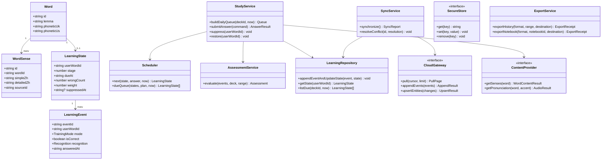
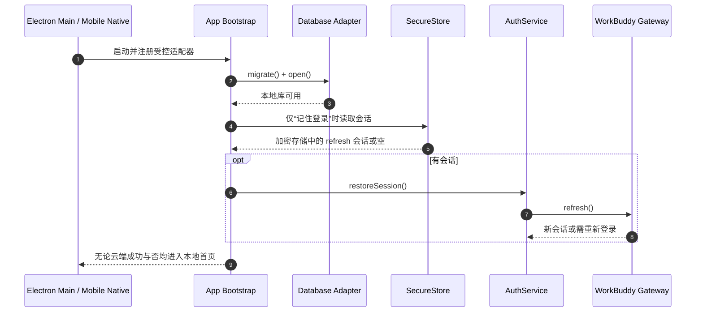
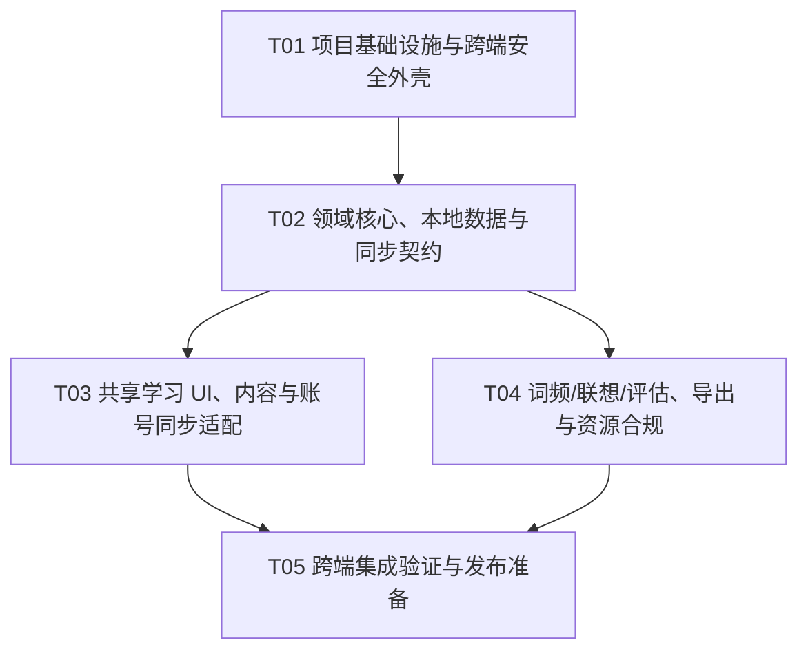

# 「我要背单词」系统架构设计与任务分解

- 文档版本：V1.0（设计稿）
- 架构师：高见远
- 输入：`docs/prd.md`
- 技术基线：React + TypeScript，Electron 桌面端，Capacitor Android/iOS，共享 Vite React UI 与学习核心
- 交付边界：只做设计，不代表依赖已安装、云服务已激活、许可证已核验或安装包已生成

## Part A：系统设计

### 1. 实现方案与框架选型

#### 1.1 核心技术难点

1. **同一套学习逻辑跨端一致**：调度、评估、冲突合并和导出字段不能分别实现，否则桌面与手机结果漂移。
2. **本地主数据与云端同步并存**：离线可完整学习；重连后事件不重复、删除不复活、设置冲突可解释。
3. **容器安全边界不同**：Electron 有主进程/预加载/渲染进程，Capacitor 有原生 WebView 与不同 Origin；云 SDK 的 CORS、OAuth 回跳和安全存储能力必须实测。
4. **数据真实性与版权**：词典、频率、音频、联想图逐项记录来源和许可，MIT 不覆盖第三方数据。
5. **可解释而非伪智能**：复习、重要性、水平评估均公开规则；缺少可靠数据时显示“未知”。
6. **跨端文件能力**：Windows 首发完成真实导出；移动端使用系统分享/保存接口，不上传第三方文档服务。

#### 1.2 总体架构

采用**模块化单体 + 本地优先（local-first）+ 端口/适配器（Ports & Adapters）**。共享 UI 只依赖应用服务接口，不直接访问 SQLite、文件系统、云 SDK 或系统 API；桌面和移动端分别提供适配器。云端是同步与在线能力适配端，不引入自建微服务。

| 层 | 职责 | 不允许做的事 |
|---|---|---|
| `apps/web` | React 页面、路由、MUI/Tailwind 样式、交互与可访问性 | 直接 SQL、持有长期 token、读取 Node API |
| `packages/core` | 纯 TypeScript 领域模型、调度、出题、评估、冲突规则 | 依赖 React、Electron、Capacitor、网络 |
| `packages/data` | SQLite migration、Repository、同步 outbox、导入校验 | 处理界面或系统通知 |
| `packages/services` | 应用用例、云/词典/音频/AI/导出端口及 DTO | 绑定单一供应商实现 |
| `apps/electron` | 主进程、IPC、better-sqlite3、keytar、托盘/自启、文件保存 | 渲染进程开启 Node integration |
| `apps/mobile` | Capacitor 配置、原生桥、SQLite、安全存储、分享/保存 | 用 Web localStorage 保存学习库或云 token |
| `packages/assets` | 资源清单、许可、版本与生成记录 | 混入无再分发权的第三方资源 |

#### 1.3 选型与理由

- **Vite + React + TypeScript**：共享 UI 与快速跨端开发；严格模式减少隐式数据错误。
- **MUI + Tailwind CSS**：MUI 提供可访问交互组件，Tailwind 仅负责布局/间距，避免两套颜色体系；主题统一白底黑字，反馈绿/错误红。
- **Zustand**：仅保存会话 UI 状态和查询快照；SQLite 才是学习数据事实源。
- **React Router**：共享路由；桌面侧栏和移动底部导航复用页面。
- **Electron + electron-builder**：Windows 首发桌面构建、托盘、自启和本地文件能力。
- **Capacitor**：复用 Web UI，使用官方/明确维护的原生插件访问移动端能力。
- **SQLite**：桌面 `better-sqlite3`，移动 `@capacitor-community/sqlite`；共享 migration 与 repository 接口。移动端插件版本、迁移和 iOS/Android 实机行为纳入 spike；V1.0 不纳入数据库静态加密。
- **WorkBuddy Cloud Service 适配层**：优先承接 Auth/Database/LLM；当前未激活，所有配置运行时注入，不写 `publicConfig`，不承诺未验证 SDK 能力。
- **本地导出**：`docx` 生成 Word，`exceljs` 生成可筛选 Excel，`pdfkit` + 明确可再分发中文字体生成 PDF；不依赖 Office 安装。
- **测试**：Vitest（核心/仓库）、React Testing Library（UI）、Playwright（Electron/关键端到端）、真实 Android/iOS 设备补充验证。

### 2. 桌面、移动与共享核心边界

```text
React 页面 → Application Services → Core Domain
                    ↓                    ↓
              Repository Ports ← SQLite Repositories
                    ↓
       Electron IPC / Capacitor SQLite / Cloud Gateway
```

- **共享**：页面文案、学习流程、DTO、调度算法、出题、水平评估、同步合并函数、导出模型、来源展示。
- **Electron 专属**：`BrowserWindow`、CSP、安全 IPC、原生菜单/托盘/自启、keytar、文件对话框、PDF 字体文件访问、音频缓存目录。
- **Capacitor 专属**：Android/iOS 工程、Origin 配置、SQLite 插件、安全存储、App 回跳、系统分享与通知（V1.x）。
- **云端专属**：账号会话、服务端表权限、同步游标、LLM 调用；绝不直接成为离线学习的硬依赖。
- **禁止的捷径**：渲染进程直连数据库；`localStorage` 存学习主库或长期 token；为兼容 Web SDK 而放宽 CSP/CORS 到任意 Origin；把设备数据库整文件上传作为同步。

### 3. 文件列表及相对路径

```text
.
├── package.json
├── pnpm-workspace.yaml
├── tsconfig.base.json
├── vite.config.ts
├── tailwind.config.ts
├── postcss.config.js
├── eslint.config.js
├── .env.example
├── index.html
├── apps/
│   ├── web/
│   │   ├── src/main.tsx
│   │   ├── src/App.tsx
│   │   ├── src/router.tsx
│   │   ├── src/theme.ts
│   │   ├── src/styles.css
│   │   ├── src/bootstrap.ts
│   │   ├── src/pages/TodayPage.tsx
│   │   ├── src/pages/StudyPage.tsx
│   │   ├── src/pages/ReviewPage.tsx
│   │   ├── src/pages/LibraryPage.tsx
│   │   ├── src/pages/NotebookPage.tsx
│   │   ├── src/pages/MistakesPage.tsx
│   │   ├── src/pages/HistoryPage.tsx
│   │   ├── src/pages/AssessmentPage.tsx
│   │   ├── src/pages/SettingsPage.tsx
│   │   ├── src/pages/AccountPage.tsx
│   │   ├── src/components/WordCard.tsx
│   │   ├── src/components/AnswerFeedback.tsx
│   │   ├── src/components/AssociationPanel.tsx
│   │   ├── src/components/SourceBadge.tsx
│   │   ├── src/components/ConflictDialog.tsx
│   │   └── src/components/AppNavigation.tsx
│   ├── electron/
│   │   ├── electron.vite.config.ts
│   │   ├── electron-builder.yml
│   │   ├── src/main/index.ts
│   │   ├── src/main/window.ts
│   │   ├── src/main/ipc.ts
│   │   ├── src/main/database.ts
│   │   ├── src/main/secureStore.ts
│   │   ├── src/main/files.ts
│   │   ├── src/main/tray.ts
│   │   ├── src/main/autoLaunch.ts
│   │   ├── src/preload/index.ts
│   │   └── resources/icon.png
│   └── mobile/
│       ├── capacitor.config.ts
│       ├── package.json
│       ├── android/                 # 由受控生成命令产生并纳入版本管理
│       ├── ios/                     # 仅源码配置；无 Mac/Xcode 时不声称可构建产物
│       └── src/native/
│           ├── database.ts
│           ├── secureStore.ts
│           ├── files.ts
│           └── cloudBridge.ts
├── packages/
│   ├── core/src/
│   │   ├── models.ts
│   │   ├── scheduler.ts
│   │   ├── queue.ts
│   │   ├── distractors.ts
│   │   ├── assessment.ts
│   │   ├── frequency.ts
│   │   ├── conflicts.ts
│   │   ├── clock.ts
│   │   └── index.ts
│   ├── data/src/
│   │   ├── migrations/001_init.sql
│   │   ├── migrations/002_sync.sql
│   │   ├── connection.ts
│   │   ├── transaction.ts
│   │   ├── wordRepository.ts
│   │   ├── learningRepository.ts
│   │   ├── syncRepository.ts
│   │   └── settingsRepository.ts
│   ├── services/src/
│   │   ├── studyService.ts
│   │   ├── contentService.ts
│   │   ├── syncService.ts
│   │   ├── authService.ts
│   │   ├── exportService.ts
│   │   ├── associationService.ts
│   │   ├── onlineService.ts
│   │   ├── ports.ts
│   │   └── dto.ts
│   ├── cloud/src/
│   │   ├── workbuddyGateway.ts
│   │   ├── cloudContracts.ts
│   │   ├── originPolicy.ts
│   │   └── config.ts
│   ├── exporters/src/
│   │   ├── exportModel.ts
│   │   ├── docxExporter.ts
│   │   ├── pdfExporter.ts
│   │   ├── xlsxExporter.ts
│   │   └── fonts/LICENSE.md
│   └── assets/
│       ├── dictionaries/manifest.json
│       ├── frequency/manifest.json
│       ├── audio/manifest.json
│       ├── associations/manifest.json
│       └── licenses/THIRD_PARTY.md
├── scripts/
│   ├── validate-assets.ts
│   ├── import-dictionary.ts
│   ├── import-frequency.ts
│   └── verify-migrations.ts
├── tests/
│   ├── core/scheduler.test.ts
│   ├── core/assessment.test.ts
│   ├── core/conflicts.test.ts
│   ├── data/syncRepository.test.ts
│   ├── services/exportService.test.ts
│   ├── e2e/study.spec.ts
│   └── fixtures/
└── docs/
    ├── prd.md
    ├── architecture.md
    ├── system_design.md
    ├── class-diagram.mermaid
    ├── sequence-diagram.mermaid
    ├── cloud-spike.md
    ├── build-windows.md
    ├── build-mobile.md
    └── privacy-security.md
```

### 4. 数据结构设计

#### 4.1 通用约定

- 主键均为 UUID/ULID 字符串；`event_id` 在客户端首次作答事务中生成，重试沿用原值。
- 时间戳使用 UTC ISO 8601 毫秒；`local_date` 为 `YYYY-MM-DD`，同时记录 IANA `time_zone`。
- 可同步实体包含 `updated_at`、`device_id`、`revision`、`deleted_at`；`revision` 为服务端确认版本，本地未同步更改不伪造服务端版本。
- 所有外部内容通过 `source_id` 关联来源；无来源不显示为“真实词频”。
- 可同步实体统一带 `created_at`（首次创建时间），仅作本地审计与导出排序依据，不参与冲突裁决；`updated_at` 才是同步比较字段。
- `learning_events` 额外冗余 `deck_id`、`word_id`（可由 `user_word_id` 反解，但事件表要能在不 JOIN `learning_state` 的前提下按词库/单词汇总，且 `learning_state` 允许被重建时历史仍可读）。
- SQL 字段使用 snake_case，TS DTO 使用 camelCase，Repository 显式映射。

#### 4.2 本地 SQLite 表

| 表 | 关键字段 | 约束/用途 |
|---|---|---|
| `sources` | `id, owner_scope, type, name, version, url, license_code, license_url, attribution, redistribution_allowed, checksum, imported_at, updated_at, deleted_at, device_id, revision` | 词典、频率、音频、图片、字体统一溯源；自建内容来源也可同步 |
| `words` | `id, owner_scope, lemma, normalized_lemma, language, phonetic_uk, phonetic_us, created_at, updated_at, deleted_at, device_id, revision` | 标准化小写、去首尾空白；保留原词形；自建词跨端同步 |
| `word_senses` | `id, word_id, sense_no, pos, simple_zh, detailed_zh, context_text, source_id, updated_at, deleted_at, device_id, revision` | `(word_id,sense_no,source_id)` 唯一；多义项按序展示；自建释义跨端同步 |
| `decks` | `id, owner_scope, name, kind, source_id, created_at, updated_at, deleted_at, device_id, revision` | `kind=BUILTIN/CUSTOM/NOTEBOOK` |
| `deck_words` | `deck_id, word_id, added_at, updated_at, deleted_at, device_id, revision` | 联合主键；收藏即向 NOTEBOOK 添加 |
| `learning_state` | `user_word_id, deck_id, word_id, stage, due_at, last_reviewed_at, correct_count, wrong_count, streak_correct, last_result, weight, suppressed_at, state_updated_at, device_id, revision` | 每词每词库一条；错词统计不依赖云端重新计算 |
| `learning_events` | `event_id, user_word_id, deck_id, word_id, session_id, mode, prompt, answer, is_correct, recognition, stage_before, stage_after, due_at, answered_at, local_date, time_zone, duration_ms, device_id, synced_at` | `event_id` 主键；追加、不更新学习事实 |
| `study_sessions` | `session_id, deck_id, started_at, ended_at, local_date, time_zone, new_count, review_count, active_duration_ms, plan_snapshot_json, device_id, revision` | 完成统计和历史快照 |
| `settings` | `key, value_json, updated_at, device_id, revision, deleted_at` | 每键独立冲突；计划另存生效日期；`deleted_at` 为软删标记——`remove(key)` 需要可同步的删除，硬 DELETE 会让 `device_id`/`revision` 失去意义，也让另一端无法得知"这个键被删了"（Task 4 实现时补齐，原表遗漏） |
| `plan_windows` | `id, effective_local_date, start_minute, end_minute, time_zone, updated_at, device_id, revision, deleted_at` | 多学习时段，跨午夜需拆分 |
| `associations` | `id, word_id, kind, text, asset_uri, origin_url, source_id, generated_by, reviewed_at, created_at, updated_at, deleted_at, device_id, revision` | `kind=MEANING/HOMOPHONE/PICTOGRAPH`；`asset_uri` 为本机缓存地址不同步，`origin_url` 为可核验来源地址；不默认上传二进制 |
| `frequency_entries` | `word_id, exam, corpus_version, frequency, total_tokens, rank, equal_count, source_id` | `rank` 按 frequency 降序；同频次并列共享同一 `rank`，`equal_count` 为该并列组的条数（§8 的 `percentile=(less+0.5*equal)/knownWordCount` 需要它，否则并列值百分位偏高）；一次导入必须满足三条：①`COUNT(*) == knownWordCount`（每词一行）；②每行的 `equal_count` 等于**本并列组大小**（并列组 = 共享同一 `rank` 的行）；③同 `rank` 必须同 `frequency`。**注意不能写成 `SUM(equal_count) == knownWordCount`**：组大小为 s 的并列组在按行求和时贡献 s²，只有全无并列时才相等，照字面执行等于禁止一切并列，正好废掉该列的用途；仅允许真实导入；重要性由公开函数计算 |
| `sync_outbox` | `seq, entity_type, entity_id, operation, payload_json, created_at, attempts, last_error` | 本地事务写入，上传成功后删除 |
| `sync_state` | `account_id, cursor, last_pull_at, schema_version` | 每账号游标独立 |
| `sync_conflicts` | `id, entity_type, entity_id, local_json, remote_json, resolution, created_at, resolved_at` | 自动合并也保留可审计记录；大批量异常需提示 |
| `content_cache` | `cache_key, provider, payload_json, fetched_at, expires_at, source_id` | 在线释义/AI/音频元数据，失败不覆盖本地内容 |

`wrong_count` 仅由唯一学习事件物化；同步拉取时按 `event_id` 插入，冲突已存在则跳过，不重复加计数。`learning_state` 可由事件和状态快照重建，并提供一致性校验工具。

#### 4.3 云端逻辑表与接口

以下为**逻辑契约，不是对尚未激活的 WorkBuddy SDK 能力的虚构声明**。字段/分页/鉴权在 `cloud-spike` 后映射到真实 API。

- `profiles(user_id PK, created_at, schema_version)`
- `sources(user_id, id, type, metadata_json, updated_at, device_id, revision, deleted_at, PRIMARY KEY(user_id,id))`：只同步用户自建/在线补充内容来源；内置公共来源以稳定 ID 和 manifest 版本随应用分发，不上传第三方资源本体。
- `words(user_id, id, lemma, normalized_lemma, language, phonetic_uk, phonetic_us, updated_at, device_id, revision, deleted_at, PRIMARY KEY(user_id,id))`
- `word_senses(user_id, id, word_id, sense_no, pos, simple_zh, detailed_zh, context_text, source_id, updated_at, device_id, revision, deleted_at, PRIMARY KEY(user_id,id))`
- `decks(user_id, id, name, kind, source_id, updated_at, device_id, revision, deleted_at, PRIMARY KEY(user_id,id))`
- `deck_words(user_id, deck_id, word_id, added_at, updated_at, device_id, revision, deleted_at, PRIMARY KEY(user_id,deck_id,word_id))`
- `learning_events(user_id, event_id, payload_json, answered_at, device_id, inserted_at, UNIQUE(user_id,event_id))`
- `learning_states(user_id, user_word_id, state_json, state_updated_at, device_id, revision)`
- `study_sessions(user_id, session_id, payload_json, updated_at, device_id, revision)`
- `settings(user_id, key, value_json, updated_at, device_id, revision)`
- `plan_windows(user_id, id, value_json, updated_at, device_id, revision, deleted_at)`
- `associations(user_id, id, word_id, kind, value_json, source_id, updated_at, device_id, revision, deleted_at)`

云接口：

```ts
interface CloudGateway {
  signIn(input: SignInInput): Promise<AuthSession>;
  refresh(session: AuthSession): Promise<AuthSession>;
  signOut(session: AuthSession): Promise<void>;
  pull(request: { cursor?: string; limit: number }): Promise<PullPage>;
  appendEvents(events: LearningEventDTO[]): Promise<AppendResult>; // 服务端幂等
  upsertEntities(changes: EntityChange[]): Promise<UpsertResult>;
  translate(request: { text: string; source: 'en'; target: 'zh' }): Promise<OnlineResult>;
}
```

`PullPage` 含 `changes`、`nextCursor`、`hasMore`；服务端必须保证同账号隔离、游标单调、限速和错误码可识别。单条失败返回实体 ID，其余可继续；权限失败阻断同步并保留 outbox。

#### 4.4 同步与冲突协议

1. 登录后创建/读取账号独立本地命名空间；不同账号不得混用游标。匿名数据首次登录时默认显式询问“合并到本账号 / 保留为独立匿名空间”，在确认前不上传。选择合并时先展示词库、词、释义、学习事件、收藏、设置和潜在冲突数量摘要，再在本地事务中归属到该账号并写入 outbox，随后以原 ID 幂等上传；选择保留则匿名空间继续仅本地可用。切换账号不自动合并、不复制当前账号数据，也不把上一账号命名空间改成新账号。
2. 拉取远端游标后的变更，按依赖顺序应用 sources → words → word_senses → decks → deck_words → associations → states/settings/plan_windows → events/sessions；同一 pull 页按此顺序分批应用，缺父实体的子项保留待重试，不产生无来源释义或游离收藏。上传也按此依赖顺序，删除按反向依赖顺序并保留 tombstone。内置词与释义以稳定 ID 和 manifest 版本识别，用户不能通过同步覆盖公共内置内容。
3. 学习事件以 `(user_id,event_id)` 去重，只追加；远端重复且规范化 payload 哈希一致时返回 `duplicate`，客户端删除对应 outbox，不重复计数；同 ID 但内容不同视为冲突并停止该事件状态重放，不得直接忽略。
4. 设置按 key 比较 `(updated_at, device_id)` 做确定性 LWW；每日计划修改必须带 `effective_local_date`，历史 session 使用快照，不回写。
5. 收藏/不再出现是可恢复状态：收藏以 `deck_words.deleted_at` tombstone；`suppressed_at` 以状态变更实体同步。取消收藏、恢复均产生新时间戳，不物理删除后立即丢失依据。
6. tombstone 采用同一时间戳秩序的 LWW；`deleted_at != null` 表示删除。保留至少 90 天且所有已同步设备确认后才可由维护任务清理；V1.0 不自动物理清理云 tombstone。
7. 同毫秒由 `device_id` 字典序决胜，确保所有端结果一致；若时钟偏差超过服务端可接受范围，提示校准并以服务端接收时间辅助展示，但不改写作答时间。
8. 学习状态不直接用本地权重覆盖远端：先合并双方新事件，再按 `(answered_at, event_id)` 确定性排序重放；状态快照仅作基线。无法重放时保留冲突并提示，不静默清零。
9. 同步事务失败保留本地数据和 outbox；指数退避（1s、2s、4s，上限 5min + jitter），认证过期先刷新，连续失败允许重登录。
10. 退出登录默认撤销当前设备长期会话并停止同步，**不删除本地学习数据**；清除本地与删除云数据是单独、二次确认操作。

### 5. 可解释学习与复习算法

#### 5.1 默认参数

- 艾宾浩斯阶段间隔：默认 `INTERVALS=[1, 2, 4, 7, 15, 30]` 天，数组下标为 `0..5`。`stage=-1` 明确表示从未成功进入复习阶段，不是数组下标；非负 `stage` 表示**当前已到达的阶段，本次到期时间由 `INTERVALS[stage]` 计算**。下一次答对且“认识”时先升 stage，再用新 stage 的间隔。默认 stage 范围 `0..5`，自定义配置通用范围为 `0..LAST_STAGE`。
- **新词第一次作答后的确定行为**：答对且“认识”时 `stage: -1→0`，使用 `INTERVALS[0]=1`，因此在作答时间后的下一个本地日到期；答对但“不认识”时保持 `stage=-1`，也在次日到期；答错时保持 `stage=-1`，10 分钟后重练。随后重练答对且“认识”仍执行 `-1→0`，从该次作答起 1 天后到期，不会提前使用 2 天间隔。之后每次答对且“认识”执行 `stage=min(stage+1,5)` 并取新 stage 对应间隔；到达 `stage=5` 后持续使用 30 天。
- 到期时刻统一由“作答时间加指定天数得到目标本地日，再取当天学习窗口开始时刻”计算；无学习窗口则用 09:00。若所得时刻不晚于作答时刻，则取下一个有效窗口，避免当天提前作答后立刻再次到期。
- 新词与复习分开配额；复习到期优先，新词不挤占已到期复习。
- 答错：`stage=max(stage-1,-1)`，连对清零，错次 +1；权重乘 `1.75`，范围 `[0.25, 4.0]`，并设置同会话 10 分钟后的短练习时间。每次作答均生成独立事件；客户端重试沿用同一 eventId，不重复计数。
- 答对且“认识”：按上述规则升阶段，连对 +1，权重乘 `0.8`；答对但“不认识”：阶段不升、权重不变，安排次日。
- 答错不直接把 `due_at` 推到明天；短练习后的下一次作答才按其结果重新计算正式到期时间。
- 高正确率降权有下限，且到期复习仍必须出现，避免“永远不再复习”。
- “不再出现”在本地事务中立即设置 `suppressed_at`，所有新词/复习/错词推荐队列过滤；恢复时清空，若已过期立即进入复习。
- 自定义复习只开放**整数天数节点与每日数量**，权重和升降级规则由系统管理。天数节点须为 `1..365` 的整数、严格递增、去重，数量 `1..12`；每日新词数和复习数均为 `0..500` 的整数且至少一项大于 0。空值、小数、负数、科学计数法、非数字、重复节点和超限输入均拒绝保存并指出字段；恢复默认可回到 `[1,2,4,7,15,30]`。`LAST_STAGE=INTERVALS.length-1`，自定义节点只替换数组并保存于计划快照；已有到期时间不追溯改写，下一次作答时将新 stage 限制在新 `LAST_STAGE` 内，缩短节点不会越界。

#### 5.2 每日队列与权重

```pseudo
buildDailyQueue(user, deck, now, zone, plan):
  today = localDate(now, zone)
  states = dueStates(deck, now).filter(s => s.suppressedAt == null)
  reviewPool = states.filter(s => s.lastReviewedAt != null AND s.dueAt <= now)
  reviewPool.sortBy(overdueDays DESC, weight DESC, dueAt ASC, wordId ASC)
  reviews = takeAtMost(reviewPool, plan.dailyReviewLimit)

  newPool = unseenWords(deck)
      .minus(wordsAlreadyLearned)
      .filter(notSuppressed)
      .sortBy(deckOrder, wordId)  # 不用未知词频伪造优先级
  newWords = takeAtMost(newPool, plan.dailyNewLimit)
  return interleaveWithoutAdjacentDuplicate(reviews, newWords)

onAnswer(state, answer, now):
  assert eventId not already processed
  if answer.isCorrect:
    state.correctCount += 1
    state.streakCorrect += 1
    if answer.recognition == KNOWN:
      state.stage = min(state.stage + 1, LAST_STAGE)
      state.weight = clamp(state.weight * 0.8, 0.25, 4.0)
      state.dueAt = nextLocalDue(now, INTERVALS[state.stage])
    else:
      state.dueAt = nextLocalDue(now, 1 day)
  else:
    state.wrongCount += 1
    state.streakCorrect = 0
    state.stage = max(state.stage - 1, -1)
    state.weight = clamp(state.weight * 1.75, 0.25, 4.0)
    state.dueAt = now + 10 minutes
  state.lastReviewedAt = now
  atomically: assert eventId still absent; insert event + persist state + outbox
```

同词累计错误达到 2 次时，提交后显示“该词已累计答错 N 次”。队列优先级中的 `weight` 只影响同逾期程度内排序，并可用受控加权抽样避免固定顺序；测试使用注入随机种子。

#### 5.3 漏学、跨时区与修改计划

- 漏学不生成空白“已学习”记录，也不把每天未做题复制成大量逾期事件；所有真实到期项保留，按逾期天数优先，受当日复习上限约束。
- 超过上限的积压保留到次日，并显示积压数；可提供“今日补学”显式增加本次上限，不回改历史计划。
- 跨时区以事件发生时的 UTC 和原时区确定历史 `local_date`，历史日期不重写；新队列使用当前时区，并提示“时区已变化，今日任务按当前时区重新计算”。
- `due_at` 存 UTC；生成时由本地目标时间转换，处理 DST 不存在/重复时间：不存在则顺延到下一个有效时间，重复则取首次出现。
- 修改每日数量或时段从 `effective_local_date` 生效；默认次日，用户可明确选择“今日剩余任务”。已完成 session 的 `plan_snapshot_json` 永不重算。

#### 5.4 学习时长

每 15 秒记录活跃心跳；页面隐藏、锁屏或窗口失焦超过 60 秒暂停。单段间隔超过 60 秒只计前 60 秒，防止整夜挂机电量/时长虚高。完成页统计来自同一 session，不与历史页各自计算。

### 6. 训练模式与相似干扰项

- `EN_TO_ZH`：展示英文、音标（可配置延迟显示），选项为中文义项。
- `ZH_TO_EN`：展示中文简解，选项为英文 lemma。
- `MIXED`：每个 session 用有种子的 50/50 随机序列，避免同词连续重复；用户选择记录于计划快照。
- “遮住中文翻译”只遮学习卡上的释义，不遮作答所需提示；提交后按模式显示正确释义。
- 默认 4 个选项，正确答案位置由有种子的 Fisher–Yates 洗牌确定。

```pseudo
generateDistractors(target, candidates, mode, seed):
  pool = candidates.filter(validLanguage, notTarget, notDuplicateAnswer)
  # 被“不再出现”的词可作干扰项，但不产生学习状态；避免缩窄题库。
  if mode == EN_TO_ZH:
    preferred = samePartOfSpeech + nonOverlappingChineseSenses
    semanticScore = sharedPos*0.45 + sharedTopicIfLicensed*0.35 + lengthSimilarity*0.20
  else:
    normalized = lowercaseUnicode(target.lemma)
    editScore = 1 - levenshtein(normalized, candidate)/maxLength
    spellingScore = editScore*0.65 + samePrefixScore*0.20 + lengthSimilarity*0.15
  ranked = stableShuffle(pool, seed).sortBy(similarity DESC, wordId ASC)
  choose 3 distinct answers; avoid near-duplicate acceptable translations
  if insufficient: relax similarity tier, never invent a word/definition
```

同义答案可能导致多个选项可接受时，该候选剔除；无足够干扰项则切换为“拼写/输入作答”或明确提示题库不足，不伪造选项。

### 7. 词典、发音、图词联想与失败降级

#### 7.1 内容接口

```ts
interface ContentProvider {
  getSenses(word: string): Promise<WordContentResult>;
  getPronunciation(word: string, accent: 'uk'|'us'): Promise<AudioResult>;
}
interface AssociationProvider {
  list(wordId: string): Promise<Association[]>; // 本地文字/已缓存图片
  resolve(wordId: string, kind: AssociationKind, allowNetwork: boolean): Promise<Association>;
  evictCachedImage(associationId: string): Promise<void>; // 不删除文字与来源记录
}
```

- 本地内置 ECDICT 候选数据仅在仓库、具体版本及 MIT 条款核验后导入；保留上游许可和字段转换说明。
- 在线详解候选 `dictionaryapi.dev`、Wiktionary；在线音频可用 Wikimedia 合规文件。每项显示名称、版本/抓取日期、链接、许可与“在线内容”。请求失败/超时（默认 8s）可重试，已有本地释义继续可用。
- 不对无再分发权的在线内容做批量内置；缓存只按条款允许的范围和期限保存。无音频时按钮仍可发现，但点击明确显示“暂无英/美式发音”，不播放空白或合成音冒充原音。
- 音频播放互斥，切换词停止上一音频；音量设置只影响应用播放，不修改系统音量。
- AI 翻译优先经 WorkBuddy LLM 网关，结果标记“AI 生成，仅供参考”，不与词典义项混排。只发送用户主动提交的文本，不发送账号 token、学习历史或整本词库。
- 图词联想为 V1.0 必交付，覆盖策略已决定：**核心词内置合规图片，其余词提供文字联想，并允许用户主动联网获取或生成图片、逐步缓存**。核心词清单按内置词库分别维护在带版本的 manifest 中，清单内每一项必须通过资源与许可校验；不能仅因某词有图片就将其视为核心词。
- 三类联想统一支持意义、谐音、象形。本地图片必须原创、合法授权或合规生成；manifest 记录 prompt/生成工具（若适用）、来源、许可、作者、审核状态、校验和。联网获取或生成必须由用户明确触发，展示预计数据去向与生成属性，不批量后台抓取；结果经格式、内容、来源与许可校验后写入缓存和 manifest，缓存键包含词、联想类型、提供方与内容版本。
- 非核心词无缓存时优先展示文字联想；离线、未授权、生成失败或许可不明时保留文字内容并明确提示“暂无合规图片”，可使用本地重试/删除缓存操作，不能使用第三方产品图占位。图片二进制默认只在本机缓存，不随账号同步；跨端同步文字联想及合法资产元数据/`origin_url`（不同步本机 `asset_uri`），另一设备按需重新获取或生成并再次校验许可。

#### 7.2 统一错误语义

`NETWORK_OFFLINE / TIMEOUT / UNAUTHORIZED / RATE_LIMITED / NOT_FOUND / SOURCE_UNAVAILABLE / INVALID_CONTENT / STORAGE_FULL / EXPORT_FAILED`。UI 用用户可理解提示并保留详情日志；在线失败不删除缓存、不回滚作答。

### 8. 考研词频与重要性公开分级

候选来源为 `exam-data/NETEMVocabulary`，但**交付前必须核验真实仓库、提交哈希、数据许可证 CC BY-NC-SA 4.0、代码 MIT 及再分发条件**；数据许可与代码许可分开记录。非商业和相同方式共享约束可能限制商业分发，未获主理人确认不得内置。若核验失败则该来源不启用，频率显示“未知”。

- `frequency` 是数据集中该词在指定考研英语一语料版本中的原始出现次数，不是模型估计。
- 仅对 `frequency > 0` 且来源、版本、总语料 token 数完整的词分级；按该版本**有频率词条集合**计算百分位，而非凭经验给固定次数。
- 规则：`P90–P100=高`，`P60–<P90=中`，`P0–<P60=基础`；并列值使用相同百分位，边界固定为 `percentile = (less + 0.5*equal)/knownWordCount`。
- 无记录、频次为 0 的语义未定义、来源不完整或词形无法可靠映射时，频率和重要性均显示“未知”；绝不将未知当低频。
- 展示“考研英语一 / 数据集名 / 版本或提交 / 统计口径 / 来源链接 / 许可”。词形归一只使用公开映射，保留原词形；不在无依据时合并不规则派生词。

### 9. 可解释水平评估

评估是**所选词库内学习表现参考**，不是 CEFR、雅思或考研分数。按词库和最近 90 天计算，至少 30 个不同词且至少 60 次有效作答才给等级；否则仅显示当前指标和“样本不足”。

```text
A = 最近 90 天加权正确率（最近 30 天权重 0.6，其余 0.4）
R = “认识”次数 / 有效作答次数
M = 到期复习中，在到期后 48 小时内答对的比例；若无符合样本则取中性值 0.5 并明确标记“复习样本不足”。M 依赖 `learning_events.due_at`：作答事件记录“本次作答所履行的那次到期时间”，新词首答（`stage_before=-1`）无到期概念，`due_at` 为 NULL、不计入 M；复习事件写入作答前 `learning_state.due_at`。
E = exp(-wrongEvents / max(distinctAttemptedWords, 1))
S = 100 * clamp(0.50*A + 0.15*R + 0.25*M + 0.10*E, 0, 1)
coverage = 至少答对一次的不同词数 / 当前词库词数
confidence = min(1, distinctWords/100) * min(1, validAnswers/200)
```

- 等级：样本达标且 `S≥85` 为“稳定掌握”，`70–<85` 为“较稳固”，`50–<70` 为“建设中”，`<50` 为“需加强”。
- 展示样本量、覆盖词库、coverage、confidence、时间范围、算法版本、生成日期和各分项。coverage 与 S 分开，避免只练少量词却声称整体水平高。
- 建议由最大短板确定：正确率低→复习错词；M 低→减少新词、清理逾期；coverage 低→增加新词；R 与 A 差异大→减少猜测并增加语境练习。
- 局限：选择题有猜测概率，词库范围偏差、自评“认识”主观、跨端时区与样本选择均影响结果；不预测标准化考试成绩。算法改动使用新 `algorithm_version`，历史评估不重写。

### 10. Word / PDF / Excel 本地导出

统一 `ExportModel`：`title, exportedAt, timeZone, sourceScope, columns, rows, footnotes`。历史、单词本、词库共用字段定义和格式化函数。

- **Word (`.docx`)**：A4、标题、导出时间、表格重复表头、长文本自动换行；按数据量分表，附来源与许可说明。
- **PDF (`.pdf`)**：PDFKit 流式生成，内嵌已核验可再分发的中文字体（候选 Noto Sans CJK，仍需核验具体字体许可）；A4 分页、页码、重复表头、长文本换行，禁止截字。中文字体缺失时阻止导出并明确提示，不生成方框乱码文件。
- **Excel (`.xlsx`)**：首行冻结、自动筛选、合理列宽、单元格换行、日期用 ISO 字符串避免时区歧义；数字字段保持数值，工作表名合法且不超过 31 字。
- 公式注入防护：以 `= + - @` 开头的用户文本转为字符串并前置 `'`；导出前校验路径、磁盘空间与非法文件名字符。
- Electron 使用保存对话框和原子临时文件重命名；Android/iOS 写入应用缓存后调用系统分享/保存。只报告系统确认写入后的成功，不声称用户已在分享面板完成保存。

### 11. 账号、安全、隐私与错误处理

#### 11.1 登录与 token

- Auth 优先 WorkBuddy Cloud Auth；界面只通过 `AuthService` 获取会话状态，不接触数据库密码。
- “记住登录”开启时，Electron refresh token 存 keytar（Windows DPAPI 等系统钥匙链），Capacitor 存经过验证的 Secure Storage 插件；关闭时仅内存保存会话，应用退出需重新登录。
- access token 尽量内存持有；日志、导出、崩溃报告和 React 状态持久化均不得包含 token。
- 登出撤销可撤销的 refresh session、删除安全存储项、清空内存账号状态；本地数据保留并明确说明。
- SDK 不支持某容器时，不擅自改成 localStorage；在网关内使用受支持的原生认证/安全存储方案或声明该平台同步暂不可用，并返回明确错误。

#### 11.2 Origin 与云 SDK 风险

Electron 推荐使用受控自定义协议（如 `app://`）或本地文件生产加载的明确 allowlist；Capacitor Android/iOS 默认 WebView Origin 可能不同。必须做真实 spike 验证：

1. Auth 登录/刷新/回跳是否允许对应 Origin；
2. Database/LLM 请求的 CORS、TLS、证书和网络错误；
3. token 刷新是否能在后台恢复；
4. SQLite 插件与云 SDK 在 WebView 的兼容性；
5. Electron 主进程代理是否必要，以及代理是否仍保持账号隔离、不记录敏感数据。

不得设置 `webSecurity:false`、`nodeIntegration:true` 或允许任意远端页面使用 preload API。渲染进程 CSP 仅允许必要连接源，IPC 使用固定频道、DTO 校验和 sender 校验。

#### 11.3 隐私与日志

- 默认本地学习；未登录无需云端。同步前说明上传字段，第三方在线内容请求仅含所查单词/文本和必要技术元数据。
- 不发送完整学习历史给词典或 LLM；导出文件不自动上传。
- 本地日志脱敏并限制大小，不记录完整 token、密码、AI 输入内容或音频。
- V1.0 **不承诺 SQLite 静态加密**；数据库文件保护依赖操作系统账号、设备锁与文件系统权限。只有 token 使用系统安全存储。若后续版本提出 SQLCipher，需另行评估桌面/移动一致性、迁移与密钥恢复，不在 V1.0 宣称数据库已加密。

### 12. 桌面托盘与自启

- `autoLaunchEnabled=false`、`minimizeToTrayEnabled=false` 为全新安装默认值，两个设置独立持久化，不参与移动端展示。
- 开启自启使用 Electron `app.setLoginItemSettings` 或构建器支持的平台机制，读取实际系统状态；失败提示，不在 UI 假报成功。
- 仅开启“最小化到托盘”时，关闭/最小化行为按明确文案执行；托盘菜单含“打开我要背单词”“退出”。退出必须真正终止，不继续后台学习。
- 恢复窗口时重建已销毁窗口、聚焦并恢复路由；单实例锁避免托盘重复启动。
- Windows 安装图标与应用名均为“我要背单词”。NSIS 使用 assisted installer（`oneClick=false`），提供“仅当前用户 / 为所有用户安装”选择；默认仅当前用户且不默认强制提权，只有用户主动选择所有用户安装时才通过系统 UAC 请求管理员权限。安装目录可改，拒绝/取消提权时不得假报成功，可返回当前用户安装选项；应用本身不要求管理员运行。macOS/Linux 配置真实存在，但仅在实际构建后声明验证。

### 13. 数据结构与接口类图



### 14. 程序调用流程

#### 14.1 作答、调度与同步

```mermaid
sequenceDiagram
autonumber
actor U as 用户
participant UI as StudyPage
participant S as StudyService
participant Q as Scheduler
participant R as LearningRepository
participant DB as SQLite
participant Y as SyncService
participant C as CloudGateway
U->>UI: 提交答案与认识/不认识
UI->>S: submitAnswer(command 含 eventId)
S->>R: getState(userWordId)
R-->>S: 当前状态
S->>Q: next(state, answer, now)
Q-->>S: 新阶段/到期时间/权重
S->>R: appendEventAndUpdateState(event, state)
R->>DB: BEGIN; 检查 eventId; 插入事件+更新状态+outbox; COMMIT
DB-->>R: 持久化成功（重复事件则幂等返回）
R-->>S: 提交结果
S-->>UI: 绿色/红色反馈及累计错次
UI-->>U: 展示结果，可继续学习
opt 已登录且在线
  Y->>R: 读取 outbox 与游标
  Y->>C: appendEvents(同 eventId)
  C-->>Y: inserted 或 duplicate
  Y->>C: pull(cursor)
  C-->>Y: 幂等变更页
  Y->>R: 去重合并并推进游标
end
```

#### 14.2 初始化与登录



### 15. 测试策略

- **核心单元测试**：固定时钟/种子覆盖新词首次答对认识→1 天、答错重练不跳级、各间隔、答错退级、错 2 次提示、权重上下限、自定义节点边界/缩短后不越界、每日数量非法输入、不再出现/恢复、逾期积压、DST、跨时区、计划生效日、干扰项唯一性、评估样本边界和未知词频。
- **性质/不变量测试**：任意同步顺序得到同一合并结果；重复事件不增加计数；tombstone 不被旧状态复活；无正确率的词不被错误标为已掌握。
- **仓库测试**：桌面和移动共享 SQL migration、事务回滚、outbox 原子性、游标断点、自建 words/word_senses/sources 依赖顺序、匿名合并确认与取消、多账号隔离；升级旧版本后数据保留。
- **契约测试**：用录制但脱敏的 fixture 验证词典/音频来源；WorkBuddy 真实沙箱激活后再运行 Auth/Database/LLM 集成测试，未激活时只跑 fake adapter 并明确跳过原因。
- **UI/E2E**：三类训练、收藏、详解、发音失败、完成统计、断网恢复、同步冲突、字体/音量、键盘和触屏可访问性；视觉检查白底黑字、答对绿/答错红及安全区遮挡。
- **导出金样测试**：中文、多义项、超长文本、大数据分页、Excel 筛选和公式注入；Windows 用真实阅读器抽查打开。
- **安全测试**：CSP、IPC 参数注入、token 不进日志/localStorage、退出撤销、陌生账号不串库、导出路径校验。
- **平台验证**：Windows 当前用户安装（无管理员权限）、所有用户安装（主动 UAC）、取消提权、安装/启动/托盘/自启默认关闭为 V1.0 阻断；Android 实机构建验证；无 Mac/Xcode/签名时 iOS/macOS 仅提供源码、配置与未验证说明。

## Part B：任务分解

### 16. Required Packages

```text
- react / react-dom: 共享 UI
- typescript / vite: 类型系统与构建
- react-router-dom: 共享路由
- @mui/material / @emotion/react / @emotion/styled: 可访问组件
- tailwindcss / postcss / autoprefixer: 布局与响应式样式
- zustand: 非事实源的 UI 状态
- zod: IPC、导入、网络 DTO 校验
- electron / electron-builder: 桌面容器与安装包
- keytar: 桌面系统钥匙链（需验证当前 Electron/Node ABI）
- better-sqlite3: Electron 主进程 SQLite（需原生模块 rebuild）
- @capacitor/core / cli / android / ios: 移动容器
- @capacitor-community/sqlite: 移动 SQLite（需实机验证）
- @aparajita/capacitor-secure-storage 或经 spike 选定的等价插件: 移动安全存储
- @capacitor/filesystem / share: 移动导出保存与分享
- docx / exceljs / pdfkit: 本地 Word/Excel/PDF 导出
- uuid: 事件与实体 ID（也可统一改用 Node/Web crypto.randomUUID）
- vitest / @testing-library/react / playwright: 单元、组件与 E2E 测试
```

不在设计阶段固定未经安装验证的精确版本；实施时锁版本并生成 lockfile。WorkBuddy SDK 包名、能力与配置必须由受信 UI/官方文档取得后加入，不能猜测。

### 17. 有序任务列表（最多 5 项）

| Task ID | Task Name | Source Files（主要范围，含对应测试） | Dependencies | Priority |
|---|---|---|---|---|
| **T01** | **项目基础设施与跨端安全外壳** | 根 `package.json`、workspace/TS/Vite/Tailwind 配置、`index.html`、`apps/web/src/main.tsx`、`App.tsx`、`bootstrap.ts`、Electron main/preload/builder 配置、`apps/mobile/capacitor.config.ts`、移动原生适配器骨架 | 无 | P0 |
| **T02** | **领域核心、本地数据与同步契约** | `packages/core/*`、`packages/data/migrations/*`、repositories、`packages/services/{studyService,dto,ports}.ts`、`packages/cloud/{cloudContracts,config,originPolicy}.ts`、核心/同步测试 | T01 | P0 |
| **T03** | **共享学习 UI、内容与账号同步适配** | `apps/web/src/pages/*`、`components/*`、`router.tsx`、`theme.ts`、`services/{contentService,syncService,authService,associationService,onlineService}.ts`、`packages/cloud/workbuddyGateway.ts`、Electron IPC/secureStore/tray/autoLaunch、移动 secureStore/cloudBridge | T02 | P0 |
| **T04** | **词频/联想/评估、导出与资源合规** | `core/{assessment,frequency}.ts`、`services/exportService.ts`、`packages/exporters/*`、`packages/assets/*`、`scripts/{validate-assets,import-dictionary,import-frequency}.ts`、导出与评估测试 | T02 | P0 |
| **T05** | **跨端集成验证与发布准备** | `tests/e2e/*`、`scripts/verify-migrations.ts`、`docs/{cloud-spike,build-windows,build-mobile,privacy-security}.md`、README/THIRD_PARTY、Electron builder 与移动配置的集成修正、Release 说明 | T03、T04 | P0 |

实施顺序：T01 → T02 →（T03、T04 可并行）→ T05。云资源仅在设计获批后由主理人通过受信 UI 激活；T03 可先以明确标注的 fake gateway 开发本地流程，但真实同步验收必须由 spike 和真实服务完成，不得把 fake 结果算作通过。

### 18. Shared Knowledge / 共享约定

- 所有应用服务结果使用 `{ ok: true, data } | { ok: false, error: { code, message, retryable } }`；不得将异常栈直接展示给用户。
- API 时间使用 ISO 8601 UTC；历史本地日期同时保留时区。ID、版本、算法版本与来源 ID 必填。
- 本地 SQLite 是学习主数据，Zustand 不是；云同步失败不阻塞作答提交。
- 所有数据库写入包裹事务；学习事件、状态更新、outbox 必须同事务。
- 所有渲染进程入参用 zod 校验；不在 React 中保存 token，不使用 localStorage 存主库/token。
- 白底黑字；绿色只表示答对，红色用于答错和必要错误。颜色之外还必须有文字/图标，满足可访问性。
- 来源、许可、版本和署名随内容保存；无法确认再分发许可的资源不进入安装包。频率未知显示“未知”。
- 默认托盘和自启关闭；桌面专属设置不同步到 iOS/Android。
- Windows 为首发必交付；其他平台只报告实际构建/签名/验证结果。
- 图词联想和水平评估是 V1.0 必须项；系统通知为 V1.x，不阻塞 V1.0。

### 19. 任务依赖图



### 20. 关键验证 Spike、已决边界与待明确事项

1. **WorkBuddy Cloud（最高风险）**：激活后验证真实 SDK 包、Origin allowlist、Auth 回跳、refresh token 生命周期、Database 查询/唯一约束/游标、LLM 配额和移动端兼容；形成 `docs/cloud-spike.md`。若不满足，主理人需决定原生 Auth 方案或延期云同步，不能降级为不安全 token 存储。
2. **SQLite/安全存储 ABI**：验证 Electron rebuild、Android/iOS 插件与数据库迁移；keytar 若维护/ABI 不满足，选用系统钥匙链等价方案后再实施。
3. **数据许可**：主理人交付前核验 ECDICT 真实仓库 MIT、`exam-data/NETEMVocabulary` 数据 CC BY-NC-SA 4.0 与代码 MIT、dictionaryapi.dev/Wiktionary/Wikimedia 每项条款。NC-SA 对预期分发模式的适用性需明确，必要时放弃内置词频。
4. **内置词库范围**：四级、六级、考研英语一的词目清单、去重/词形规则和缺失多义项如何补足，须有合法来源和验收样本。
5. **联想覆盖（已决定，不再待定）**：核心词内置经许可与内容审核的合规图片；其余词 V1.0 提供文字联想，并支持用户主动联网获取或生成图片后逐步缓存。核心词清单随版本 manifest 固化并可验收，不要求所有词在首发时内置图片；无合规图不得冒充完成。具体在线生成提供方仍取决于已激活服务和隐私条款。
6. **匿名数据与多账号（已决定）**：匿名数据首次登录默认显式询问是否合并，合并前展示数量与冲突摘要；可保留独立匿名空间。任何多账号切换均不自动混库，详见 4.4。
7. **自定义复习（已决定）**：V1.0 仅开放整数天数节点和每日数量，采用 5.1 的范围与非法输入校验；权重和升降级由系统管理。
8. **本地静态加密（已决定）**：V1.0 不承诺 SQLite 静态加密，只承诺 token 安全存储及操作系统级文件保护，不将 SQLCipher 列为首发隐含工作。
9. **构建条件（仍待环境确认）**：Android 签名、macOS/Xcode、Apple 开发者账号与公证条件未提供；只能按实际环境交付，尤其不得声称 iOS/macOS 安装包已验证。Windows assisted installer 的当前用户/所有用户选择已确定，见第 12 节。
10. **系统通知（已决定）**：明确排入 V1.x，接口预留但不纳入 V1.0 验收阻断。
